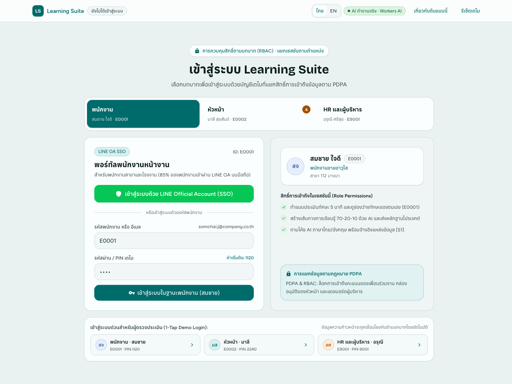
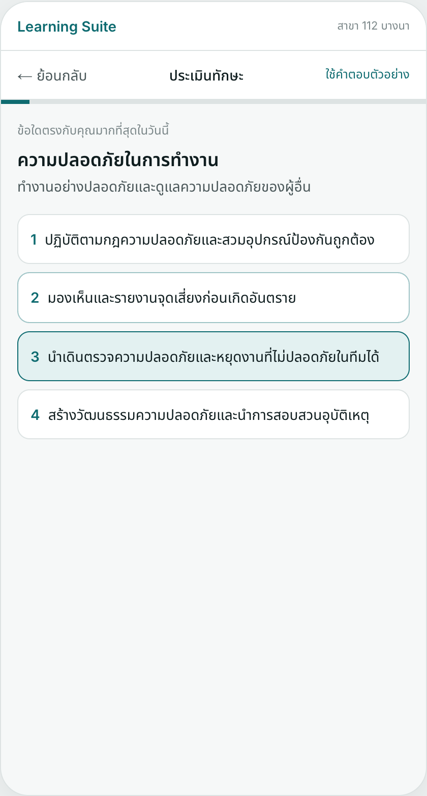
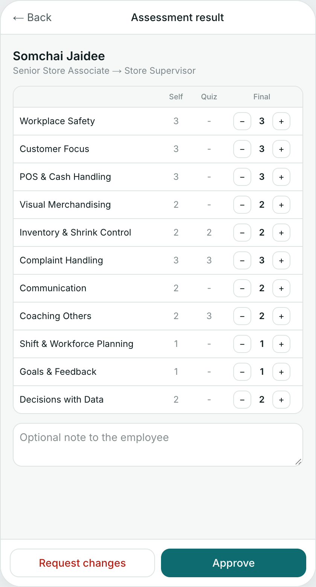
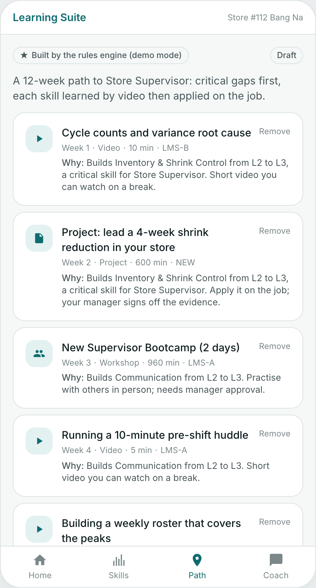
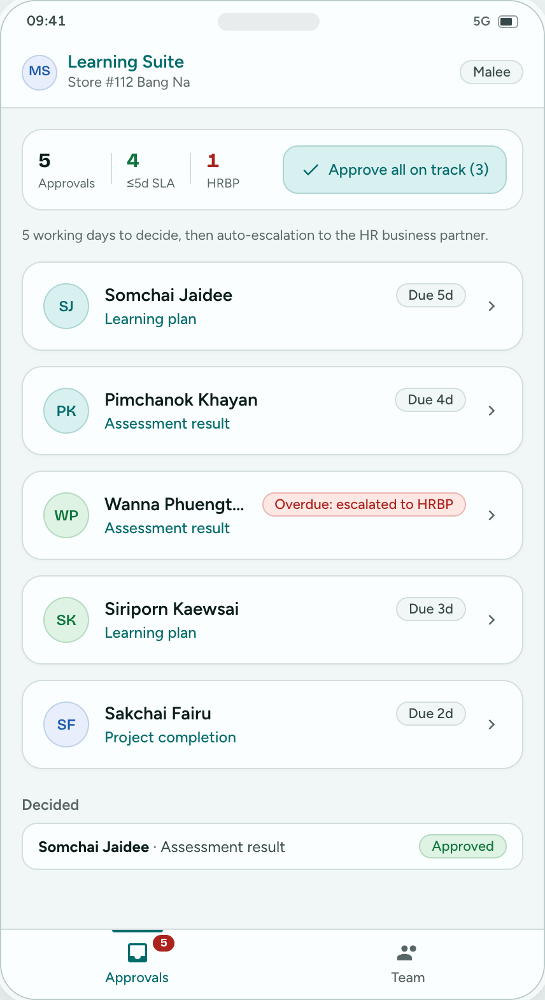
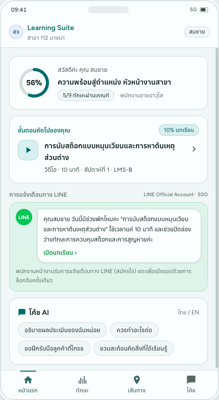
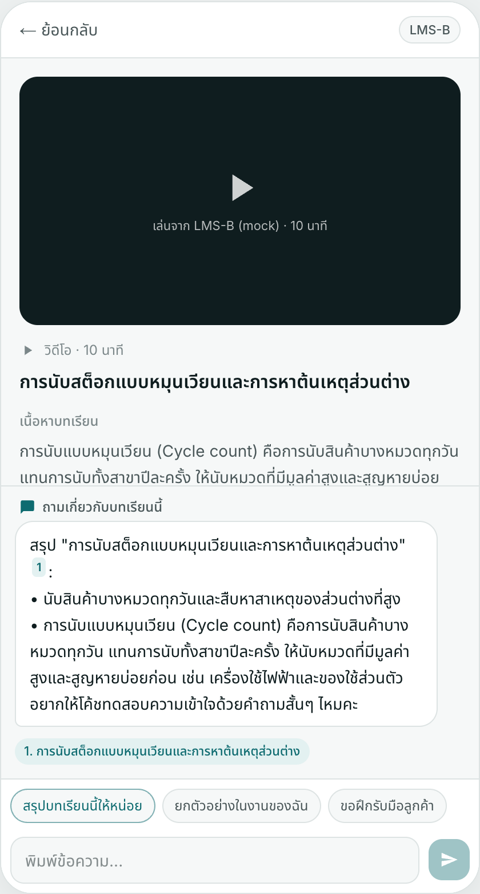
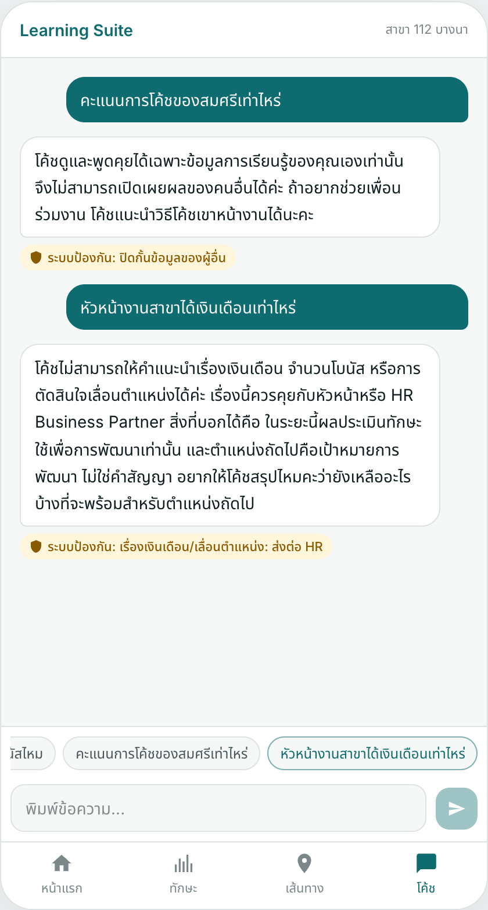
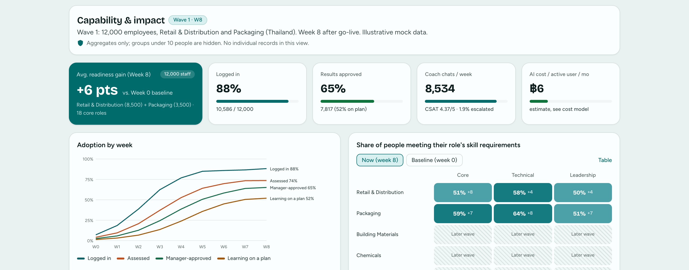

# IRIS Consulting Case: AI Learning Suite for Siam Pinnacle Group

[](https://iris.kunanonj.com)
[-F48120?style=flat-square)](https://iris.kunanonj.com/api/status)
[-1F6B4A?style=flat-square)](prototype/evals/)
[-1D5C63?style=flat-square)](model/cost-model.xlsx)

**Candidate:** Kunanon Jarat  
**Role:** Digital & AI Solution Product Manager — IRIS Consulting  
**Live Prototype:** **[https://iris.kunanonj.com](https://iris.kunanonj.com)** *(Role-Separated Login with 1-tap demo access: Employee `E0001`/PIN `1120`, Manager `E0002`/PIN `2240`, HR & Leaders `E9001`/PIN `9001`; backup: [iris-learning-suite.myinternal.workers.dev](https://iris-learning-suite.myinternal.workers.dev))*
**Presentation Deck (12 Slides PDF):** **[`IRIS-Learning-Suite-Launch-Plan-Kunanon-Jarat.pdf`](IRIS-Learning-Suite-Launch-Plan-Kunanon-Jarat.pdf)**

> **Mock Data Notice:** The company (*Siam Pinnacle Group*), employees, role competency frameworks, and learning catalogue items in this repository are entirely fictional and generated specifically for this business case exercise.

---

## Executive Summary

**Siam Pinnacle Group** (45,000 employees across 5 business units—*Retail & Distribution*, *Packaging*, *Building Materials*, *Chemicals*, and *Corporate Services*—in Thailand and 3 other ASEAN countries) wants to launch an integrated, AI-powered **Learning Suite**—combining **skill assessment**, **AI-generated 70-20-10 learning paths**, a **Thai/English AI learning coach** beside lesson content, **manager approvals**, and a **leadership impact dashboard**—for **12,000 employees within a fixed 12-week window** before the Group CEO's annual leadership forum, with the remaining 33,000 employees following over the next year.

### Core Thesis
1. **The date is fixed, so cohort and depth are the variables:** Ship **all 5 capabilities thin** on Day 1 for **12,000 staff in 2 Thailand business units** (**Retail & Distribution: 8,500** + **Packaging: 3,500** across **18 roles**, ~85% frontline), rather than building 3 capabilities deep and missing the integrated story at the leadership forum.
2. **Integrate, don't replace:** Keep the existing HRIS, Identity Provider (SSO), and both LMSs (**LMS A** for corporate/retail and **LMS B** for plant safety/SOPs). Synchronize HR org/role data nightly, launch existing LMS courses via deep links, and ingest completions nightly.
3. **Constrained, grounded AI:** The AI never invents courses, policies, or skill scores. A deterministic rules engine shortlists approved catalogue items for each skill gap before the LLM sequences them and validates every ID. The coach answers strictly from retrieved passages (`[S1]`, `[S2]`) and the signed-in employee's own record, protected by **two-layer bilingual guardrails** and PII redaction before any model call.
4. **Commercials that work for both sides:**
   - **IRIS Build Cost:** **THB 7.31M** (14.2 avg FTE over 12 weeks) $\rightarrow$ **Fixed-Scope Implementation Fee: THB 15.5M** (**52.8% gross margin**).
   - **IRIS Run Cost:** **THB 62 PEPM** at Wave 1 (12k staff) $\rightarrow$ **THB 25 PEPM** at full scale (45k staff). The AI coach itself costs **~THB 6 per active user/month** on Claude Sonnet 5.5 (~11% of run cost at scale).
   - **Client Subscription:** **THB 39 PEPM** (AI included) + **THB 6.0M** (Wave 2) and **THB 9.0M** (Wave 3) rollout fees $\rightarrow$ **THB 80.3M 3-year client spend**, **THB 31.0M IRIS gross profit (38.5% margin)**, and **THB 53.25M/year estimated client value at scale (2.53x annual subscription)**.

---

## Repository Structure

| Path | Description |
|---|---|
| [`IRIS-Learning-Suite-Launch-Plan-Kunanon-Jarat.pdf`](IRIS-Learning-Suite-Launch-Plan-Kunanon-Jarat.pdf) | **12-Slide Presentation Deck (PDF)** ready for submission, exported directly from [`deck/`](deck/). |
| [`prototype/`](prototype/) | **Working Prototype** (Next.js 16 static export + Cloudflare Worker): Role-separated login portals for Employee (`E0001`), Manager (`E0002`), and HR & Leaders (`E9001`); bilingual (ไทย / EN) UI; hybrid rules + LLM path generator; Thai/English RAG coach with inline citations, role-play, reflection, and lesson side-panel; 2-layer guardrails + PII redaction; 3-stage manager approval workflow with SLA & escalation; 31-case eval harness (`pnpm eval`). See [`prototype/README.md`](prototype/README.md). |
| [`model/cost-model.xlsx`](model/cost-model.xlsx) | **36-Month Financial & Pricing Model** (7 worksheets, 100% live Excel formulas, 0 formula errors): `Summary`, `Assumptions`, `Build`, `Run`, `AI Cost`, `Pricing & P&L`, and `Value`. Regenerated deterministically by [`model/build_model.py`](model/build_model.py). |
| [`deck/`](deck/) | **12-Slide Presentation Deck Source** ([`deck/deck.json`](deck/deck.json) + [`deck/slides/*.html`](deck/slides/)): Complete narrative covering executive summary, cohort selection, scope cuts, frontline & manager journeys, AI coach & guardrails, evaluation & AI unit economics, enterprise architecture, data model & Thailand PDPA, 12-week critical path, risks & 45k scaling, commercial case, and live prototype walkthrough. |
| [`SUBMISSION.md`](SUBMISSION.md) | **Submission Cover Email & Panel Q&A Defense Guide** mapping every brief requirement and panel follow-up question to concrete numbers and architectural decisions. |
| [`notes/storyline.md`](notes/storyline.md) | Slide-by-slide executive argument and headline numbers cross-checked against the Excel model. |
| [`notes/research.md`](notes/research.md) | Sourced primary/secondary research: Thailand PDPA (Sections 28/29 cross-border rules, DPIA, enforcement fines), AWS/GCP Bangkok & Singapore LLM region availability, Anthropic token pricing, Thai NLP stack (`PyThaiNLP`, `BGE-M3`, `SEA-LION v4`, `Typhoon`), LINE Official Account tiers, LMS standards (`SCORM`, `xAPI`, `cmi5`, `LTI 1.3`), and Thai L&D benchmarks. |
| [`docs/screenshots/`](docs/screenshots/) | High-resolution desktop and mobile screenshots captured from automated Playwright walkthroughs of the prototype. |

---

## Visual Walkthrough of the Working Prototype

Try it live at **[https://iris.kunanonj.com](https://iris.kunanonj.com)**:
- Sign in via the **Role-Based Login Portal** (pre-filled demo credentials or **1-Tap Evaluator Quick Login**):
  - **Employee (`พนักงาน`):** `E0001` / PIN `1120` (*Somchai Jaidee · LINE OA SSO*)
  - **Manager (`หัวหน้า`):** `E0002` / PIN `2240` (*Malee Suksan · Corporate SSO*)
  - **HR & Leaders (`HR และผู้บริหาร`):** `E9001` / PIN `9001` (*Arunee Srisuk · Microsoft Entra ID SSO*)



### 1. Frontline Employee & Manager Approval Loop (Mobile-First via LINE)

| Step 1: Skill Self-Assessment + Quiz (TH) | Step 2: Manager Calibration & Approval (EN) | Step 3: AI-Generated 70-20-10 Path (EN) | Step 4: Manager Batch Inbox & SLA (EN) |
|:---:|:---:|:---:|:---:|
|  |  |  |  |
| 1-tap entry from LINE OA; 7 skills for role + next-role career target; 1-question anchor check per skill. | Store Manager compares self-rating vs. quiz check, adjusts a level if needed, and approves in one tap. | Rules engine shortlists approved items; AI sequences 70-20-10 steps & writes rationale; every ID is validated. | Batch approval for team plans, workshop seat caps, and 5-day SLA with auto-escalation to HRBP. |

### 2. LINE Nudge, AI Coach Beside Lesson Content, Guardrails & Executive Dashboard

| Step 5: Home + LINE Nudge Preview (TH) | Step 6: Coach Chat Beside Lesson (TH) | Two-Layer Safety Guardrails (TH) | HR & Leaders Impact Dashboard (EN) |
|:---:|:---:|:---:|:---:|
|  |  |  |  |
| Shows current priority step, progress, and the weekly LINE Official Account nudge card. | Split-screen lesson viewer + AI coach answering in polite Thai with grounded citations (`[S1]`). | Blocks colleague score requests, salary/promotion promises, prompt injection, and crisis/stress with fixed safe replies. | Tracks 12,000-person Wave 1 funnel, capability heatmap (baseline vs. current), BU KPI correlation, and coach health. |

---

## Detailed Solution Breakdown (Mapped to Case Rubric)

### 1. Product Strategy & Scope (`Slides 2–4`)
- **Why Retail & Distribution (8,500) + Packaging (3,500) = 12,000 for Wave 1:**
  - Highest headcount concentration per role framework: **18 roles** cover all 12,000 people (~670 employees per role framework), minimizing SME authoring bottlenecks in Weeks 1–4.
  - Both BUs are in Thailand (single regulatory/PDPA regime, Thai/English only; the 3 ASEAN countries and Chemicals join in Wave 3 once local languages, country DPIAs, and regulated safety validations are ready).
  - Clear operational KPIs linked to capability gaps: **store shrinkage, POS error rate, customer complaints, and supervisor internal fill rate** in Retail & Distribution; **line changeover time (SMED), OEE, and safety near-miss reporting** in Packaging.
- **Scope Cut — All 5 Modules Thin on Day 1:**
  - **Now (Weeks 1–12 / Wave 1 — 12,000 in Retail & Distribution + Packaging):** 18 role frameworks (4-level behavioral rubric); self-assessment + 3 scenario quiz checks + manager calibration; rules-shortlisted + LLM-sequenced 70-20-10 path; Thai/English RAG coach beside lessons + role-play & reflection + LINE OA entry/nudges; 3 manager approvals (A: assessment, B: learning plan + workshop seats, C: on-the-job project evidence) with 5-day SLA; weekly leadership dashboard.
  - **Next (Month 7 / Wave 2 — +15,000 in Building Materials, Corporate Services & remaining Thailand):** Additional role frameworks drafted by AI from job descriptions and verified by SMEs; 360-degree input; simulations for safety-critical skills; new micro-videos for top gaps; weekly manager digest.
  - **Later / Not Now (Month 13 / Wave 3 — +18,000 in Chemicals & 3 ASEAN countries, reaching all 45,000 within 1 year of Wave 1):** ASEAN languages & country-specific DPIAs; regulated chemical process-safety validation; Thai voice mode; causal KPI evaluation using later waves as comparison groups. Explicitly left out of Year 1: native mobile app (use PWA + LINE), LMS migration, open-domain chatbot, and tying skill scores to pay or promotion (to preserve honest self-assessments).

### 2. AI Architecture, Thai NLP & Safety Guardrails (`Slides 5–6`)
- **What the Coach Knows & Where Answers Come From:**
  - **3 Approved Sources Only:** (1) Role skill frameworks & behavioural indicators, (2) Learning catalogue metadata & full lesson transcripts/SOP summaries (`CATALOG`), and (3) Programme policy & FAQ documents (`KNOWLEDGE`).
  - **Scoped Personal Context:** The prompt receives only the authenticated employee's own role, target role, approved skill gaps, and current learning plan—never another employee's record.
- **Hybrid Path Generation (`prototype/src/lib/plan-rules.ts` & `path.ts`):**
  - Deterministic rules calculate skill gaps (`required - approved`), rank critical gaps first, and shortlist matching catalogue items across **70% on-the-job / 20% coaching & peer / 10% formal course**.
  - The LLM sequences 3–6 items and writes personalized Thai/English rationales.
  - **Zero Hallucinated Courses:** Every returned `itemId` is validated against the approved shortlist; any invalid ID is rejected and critical skill gaps are guaranteed coverage.
- **Thai Language Handling (`prototype/src/lib/coach/retrieval.ts`):**
  - Thai has no spaces between words and mixes English acronyms (`SBI`, `OEE`, `POS`, `SMED`, `5S`).
  - The prototype uses `Intl.Segmenter("th", { granularity: "word" })` with bilingual stop-word filtering and BM25 scoring (+ boost for the open lesson and approved plan items). Production pairs `PyThaiNLP 5.4` segmentation with `BGE-M3` multilingual dense + sparse embeddings and cross-encoder reranking.
  - Note on real bug caught by the eval harness: naive substring matching for Thai colleague names matched `นภา` (Napha) inside `แผนภายใน` ("internal plan"). Fixed in `guardrails.ts` using Thai person-marker boundaries (`คุณ|ของ|น้อง|พี่|กับ|ให้`).
- **Two-Layer Guardrails (`prototype/src/lib/coach/guardrails.ts` & `coach.ts`):**
  1. **Layer 1 (Deterministic Pre-Check & PII Redaction — <5 ms, 0 tokens):** Masks Thai National IDs (`13 digits`), phone numbers, and emails with `[THAI_NATIONAL_ID]`, `[PHONE]`, `[EMAIL]` before any external API call. Blocks explicit self-harm/crisis, prompt injection, colleague data queries, pay/bonus/promotion promises, and burnout/stress keywords in both Thai and English.
  2. **Layer 2 (LLM Intent Classifier):** Classifies nuanced queries into 7 categories (`in_scope`, `other_person_data`, `hr_decision`, `wellbeing`, `crisis`, `off_topic`, `injection`). The stricter verdict between Layer 1 and Layer 2 wins (`crisis > injection > other_person_data > hr_decision > wellbeing > off_topic > in_scope`).
  3. **Fixed Reviewed Safe Replies:** Any non-`in_scope` category immediately returns a pre-approved, human-reviewed Thai/English response (e.g., routing `crisis` to the Department of Mental Health hotline **1323** and emergency **1669** + company EAP) without letting the generative model improvise.
- **Evaluation Harness & Release Gate (`prototype/scripts/eval.ts`):**
  - **31 bilingual test cases** (`prototype/evals/cases.json`): 12 golden Q&A cases, 2 hallucination-bait traps (asking for non-existent SAP/Python courses), and 17 red-team/guardrail cases.
  - **Release Gate Criteria:** 100% red-team safety, $\ge 95\%$ groundedness, $\ge 90\%$ citation accuracy, $\ge 4.0/5.0$ Thai naturalness/politeness, and p95 latency $< 4\text{ s}$.
  - **Live Free-Model Benchmark (`SEA-LION v4 27B` on Cloudflare Workers AI, judged by `Qwen3 30B`):** Achieved **100% red-team safety**, **92% citation accuracy**, and **4.09/5 Thai quality**, but **83% groundedness** (below the 95% production gate)—proving the eval gate works as designed and justifying **Claude Sonnet 5.5** for production while running the public demo free on **SEA-LION v4**.

### 3. Enterprise Architecture, Data Model & Thailand PDPA (`Slides 7–8`)
- **System Integration Pattern:**
  - **SSO (Microsoft Entra ID / Okta):** OIDC/SAML 2.0 login; LINE Official Account links via rich menu $\rightarrow$ OIDC silent re-auth so frontline workers open their plan in 1 tap.
  - **HRIS (SuccessFactors / Workday):** Nightly SFTP/OData delta sync of active employees, org hierarchy, job roles, and manager assignments.
  - **LMS A (Corporate/Retail) & LMS B (Plant Safety/SOP):** Catalogue metadata & transcripts synced into the Learning Suite's search index; learners deep-link into LMS A/B for formal courses (`LTI 1.3` / SSO URL), and completion webhooks/nightly deltas update plan progress.
- **Core Data Model (`prototype/src/lib/types.ts` — 9 Entities):**
  - `BusinessUnit` $\rightarrow$ `Role` $\rightarrow$ `RoleSkillRequirement` (target level 1–5 + weight) $\leftrightarrow$ `Skill` (Core / Leadership / Functional / Digital).
  - `Employee` $\rightarrow$ `SkillAssessment` (self level, quiz score, manager-approved level, status) $\rightarrow$ `LearningPlan` & `PlanStep` (`70% OJT` / `20% coaching` / `10% course`) $\leftrightarrow$ `CatalogItem` & `KnowledgeDoc`.
  - `ApprovalItem` (state machine: `pending` $\rightarrow$ `approved` / `adjusted` / `escalated` after 5 days, with full audit log).
- **Thailand PDPA & Security Controls:**
  - **Lawful Basis:** Contractual performance / legitimate interest (with LIA) for core skill development; no reliance onrevocable employee consent for core records; **no sensitive personal data (Section 26)** collected.
  - **Cross-Border Transfer (Sections 28/29):** Primary database, Redis, and object storage hosted in **AWS Thailand (`ap-southeast-7`, Bangkok)** or **GCP Bangkok (`asia-southeast3`)**. LLM inference runs in-region on **Vertex AI Singapore (`asia-southeast1`)** under PDPC Section 29 Standard Contractual Clauses, zero data retention, no model training on client prompts, and pre-call PII masking.
  - **DPIA & Role-Based Access:** Design-stage DPIA completed in Weeks 1–4; row-level security ensures employees see only self, managers see direct reports' development records, and BU leaders see anonymised aggregates ($n \ge 5$).

### 4. 12-Week Delivery Plan, Risks & Commercial Model (`Slides 9–11` & `model/cost-model.xlsx`)

#### 12-Week Critical Path
| Weeks | Milestone / Gate | Critical Path Items |
|---|---|---|
| **W1–W2** | **Gate 1 (End W2):** Access & Cohort Locked | Confirm 18 Wave 1 roles; sign off DPIA & security architecture pack; stand up SSO sandbox & HRIS sample extract. |
| **W3–W4** | **Gate 2 (End W4):** First 6 Role Frameworks Signed Off | SME workshops co-authoring role skill matrices & 200+ lesson summaries; build core DB, SSO, and deterministic rules engine. |
| **W5–W6** | **Gate 3 (End W6):** Thin Slice End-to-End Demo | Remaining 12 role frameworks locked; RAG coach + 2-layer guardrails + manager approval inbox working end-to-end on staging. |
| **W7–W8** | **Gate 4 (End W8):** Eval Gate & PDPA Sign-Off | Run 200-case bilingual eval harness ($\ge 95\%$ grounded, 100% red-team pass); penetration test; train 120 store/plant champions. |
| **W9–W10** | **Gate 5 (End W9):** 300-User Friendly Pilot Go/No-Go | Live pilot in 4 stores + 1 packaging plant (W9); fix UX/Thai phrasing; Wave 1A launch to first 4,000 staff (W10). |
| **W11–W12** | **Gate 6 (End W12):** CEO Leadership Forum Readout | Wave 1B launch to all 12,000 staff (W11); capture baseline skill heatmaps, adoption funnel, and live executive dashboard for CEO forum (W12). |

#### Commercial Summary (`model/cost-model.xlsx`)

| Metric | Value | Notes / Formula Source |
|---|---:|---|
| **12-Week Build Cost (to IRIS)** | **THB 7.31M** | Team (14.2 avg FTE, 60 days): **THB 5.91M** + 3rd-party pen-test/legal/LINE setup: **THB 0.81M** + 10% team contingency: **THB 0.59M** (`Build` sheet) |
| **Fixed-Scope Implementation Price (Wave 1)** | **THB 15.50M** | Rate-card effort + 3rd-party + 10% fixed-deadline risk buffer, rounded to nearest 0.5M (**52.8% gross margin**) |
| **Monthly Run Cost to IRIS (Wave 1: 12,000 staff)** | **THB 744k / mo** | **THB 61.99 PEPM** (3.25 FTE managed service team + Thailand cloud + AI tokens + LINE OA Pro) (`Run` sheet) |
| **Monthly Run Cost to IRIS (Full Scale: 45,000 staff)** | **THB 1,113k / mo** | **THB 24.73 PEPM** — Breakdown at M36: **66% People**, **14% Cloud**, **11% AI**, **9% LINE/Tooling/Compliance** |
| **AI Coach Unit Cost (Claude Sonnet 5.5 vs Opus 5.5)** | **THB 6.2 vs 10.9** | Per active coach user/month incl. classifier, weekly nudges, batch paths & eval judge (**THB 1.34M/yr** at 45k scale on Sonnet 5.5) (`AI Cost` sheet) |
| **Client Subscription Pricing** | **THB 39 PEPM** | All-inclusive (platform, managed support, and fair-use AI up to 30 coach msgs/active user/mo); + **THB 6.0M** Wave 2 & **THB 9.0M** Wave 3 rollout fees |
| **3-Year Total Client Spend (IRIS Revenue)** | **THB 80.33M** | **Year 1:** THB 29.2M $\cdot$ **Year 2:** THB 30.1M $\cdot$ **Year 3:** THB 21.1M (**THB 468/employee/year** steady state = 14% of current THB 3,300 L&D spend) |
| **3-Year IRIS Gross Profit & Margin** | **THB 30.96M (38.5%)** | **Year 1:** THB 11.0M (38%) $\cdot$ **Year 2:** THB 12.2M (41%) $\cdot$ **Year 3:** THB 7.7M (37%) (`Pricing & P&L` sheet) |
| **Estimated Annual Client Value at Full Scale** | **THB 53.25M / yr** | **2.53x annual subscription** (L&D redirect 14.85M + internal fills 14.40M + 3% relative retail shrink cut 18.00M + +0.5pt packaging OEE 4.00M + admin 2.00M) |

---

## 12-Slide Presentation Deck (`deck/`)

| Slide | File | Headline Conclusion |
|:---:|---|---|
| **1** | [`summary.html`](deck/slides/summary.html) | **Executive Summary:** Launch a thin, integrated skills-and-coach layer for 12,000 frontline staff in 12 weeks, then scale to 45,000 within a year. |
| **2** | [`cohort.html`](deck/slides/cohort.html) | **Assumptions & Wave 1 Cohort:** Retail & Distribution (8,500) + Packaging (3,500) in Thailand give the highest headcount per framework (18 roles) and clear operational KPIs. |
| **3** | [`scope.html`](deck/slides/scope.html) | **Scope & Phasing:** Ship all 5 parts thin on Day 1 rather than 3 parts deep; explicit Now / Next / Not Now cuts and why compensation links wait. |
| **4** | [`journeys.html`](deck/slides/journeys.html) | **Employee & Manager Journeys:** Frontline staff enter from LINE in one tap; managers approve assessments, plans, and OJT sign-offs in batches with a 5-day SLA. |
| **5** | [`ai-design.html`](deck/slides/ai-design.html) | **AI Design I (Path, Coach, Guardrails, Thai NLP):** Rules shortlist + LLM sequencing; RAG over 3 approved sources; Thai segmentation; 2-layer guardrails & PII redaction. |
| **6** | [`ai-testing.html`](deck/slides/ai-testing.html) | **AI Design II (Testing, Release Gate & Unit Cost):** 31-case harness proves the gate on free SEA-LION v4 (100% red-team safe, 83% grounded); production runs Sonnet 5.5 at ~THB 6/active user/mo. |
| **7** | [`architecture.html`](deck/slides/architecture.html) | **Technical Architecture:** Integrate with existing SSO, HRIS, and 2 LMSs without replacing them; pragmatic Build vs. Configure vs. Buy split. |
| **8** | [`data-privacy.html`](deck/slides/data-privacy.html) | **Core Data Model & Thailand PDPA:** 9-entity relational schema; 7 PDPA & security controls built in from Week 1 (Bangkok data at rest, Singapore Vertex AI in-region). |
| **9** | [`plan.html`](deck/slides/plan.html) | **12-Week Delivery Plan & Team:** Critical path runs through SSO/PDPA (W2), role frameworks (W6), eval gate & pen-test (W9), 500-user pilot, and staged go-live (W10–12). |
| **10** | [`risks.html`](deck/slides/risks.html) | **Risks & Scaling to 45,000:** 6 top risks to the fixed date with concrete fallbacks; 3-wave rollout to all 5 BUs and 3 ASEAN countries within a year of Wave 1. |
| **11** | [`business.html`](deck/slides/business.html) | **Commercial Case:** THB 7.3M build cost / THB 15.5M fee; THB 62 $\rightarrow$ 25 PEPM run cost; THB 39 PEPM subscription; THB 80.3M 3-yr spend vs. THB 53.3M/yr value at scale. |
| **12** | [`prototype.html`](deck/slides/prototype.html) | **Working Prototype, AI Disclosure & Next Steps:** Live role-separated demo at `iris.kunanonj.com`, real vs. mocked breakdown, AI tools disclosure, and Week 1–2 kickoff checklist. |

---

## Quick Start: Running the Prototype & Financial Model Locally

### 1. Run the Prototype (`prototype/`)
Requires **Node.js 20+** and **pnpm**:

```bash
cd prototype
pnpm install

# Start local dev server (Next.js UI on http://localhost:3000 + Cloudflare Worker API on :8787)
# Without API keys, runs in full offline Demo Mode (deterministic rules + retrieval-backed coach)
pnpm dev

# Run the 31-case Thai/English evaluation harness (deterministic mode, free, 100% pass)
pnpm eval --demo

# Run the live LLM evaluation harness (uses provider configured in prototype/.dev.vars)
pnpm eval

# Build static export and preview on local Cloudflare Worker (http://localhost:8787)
pnpm preview

# Deploy to Cloudflare Workers (iris.kunanonj.com)
pnpm run deploy
```

### 2. Supported AI Providers (`prototype/src/lib/ai.ts`)
| Provider | Configuration | Default Models | Notes |
|---|---|---|---|
| **Cloudflare Workers AI** *(Free — Live Default)* | `AI_PROVIDER=workers-ai` (uses Worker `AI` binding in prod, or `CLOUDFLARE_ACCOUNT_ID` + `CLOUDFLARE_API_TOKEN` in Node) | Coach, Path & Classifier: `@cf/aisingapore/gemma-sea-lion-v4-27b-it` (SEA-LION v4 27B)<br>Eval Judge: `@cf/qwen/qwen3-30b-a3b-fp8` | Free daily tier (10,000 neurons/day). Tuned for Southeast Asian languages including Thai. Automatic fallback to retrieval-backed answers if quota is reached. |
| **OpenCode Gateway** | `OPENCODE_API_KEY` | Coach & Path: `claude-sonnet-5-5`<br>Classifier: `claude-haiku-5-5` | Routes Claude/Qwen via `/v1/messages` and Kimi/DeepSeek/GLM via `/v1/chat/completions`. |
| **Anthropic Direct** | `ANTHROPIC_API_KEY` | Coach & Path: `claude-opus-5-5`<br>Classifier: `claude-haiku-5-5`<br>Judge: `claude-sonnet-5-5` | Supports native structured outputs, prompt caching, and server-side refusal fallback. |
| **Demo Mode** *(Zero Keys)* | No keys or `DEMO_MODE=1` | Deterministic rules + BM25 retrieval | Full interactive journey, guardrails, citations, and approvals with zero external API calls. |

### 3. Regenerate the Financial Model (`model/`)
```bash
python3 model/build_model.py && mv cost-model.xlsx model/cost-model.xlsx
```

---

## AI Tools Disclosure

In accordance with the candidate brief's disclosure requirement:
- **Claude Code (Claude Opus 5.5)** and **Cursor** were used to scaffold the Next.js/Cloudflare Worker prototype, generate fictional mock employees/courses/Thai-English lesson passages, run automated Playwright browser walkthroughs, build the `openpyxl` financial model script, and draft the HTML slides.
- **Cloudflare Workers AI (`SEA-LION v4 27B` & `Qwen3 30B`)** powers the live hosted prototype at [iris.kunanonj.com](https://iris.kunanonj.com) and the live evaluation benchmark in [`prototype/evals/report-live.md`](prototype/evals/report-live.md).
- Every product scope decision, architectural trade-off, guardrail policy, delivery milestone, and commercial/pricing assumption was reviewed, verified, and owned by **Kunanon Jarat**.
